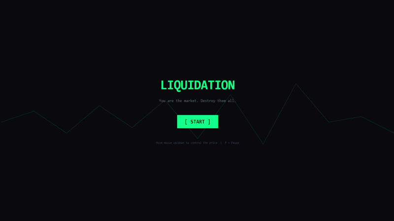
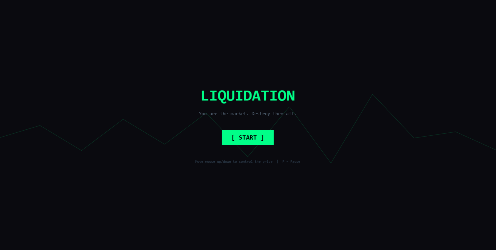
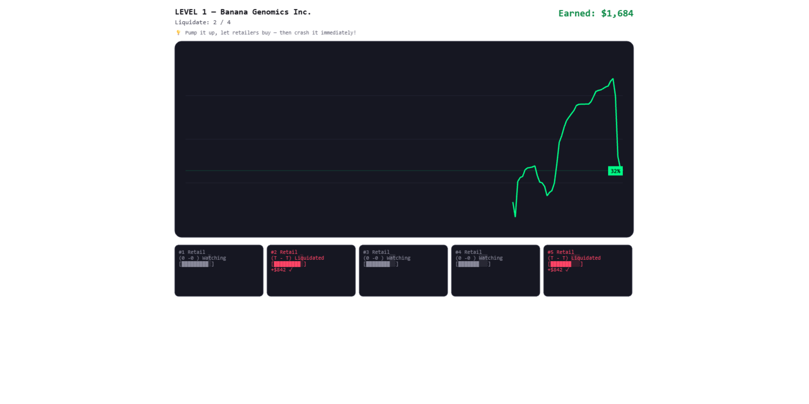
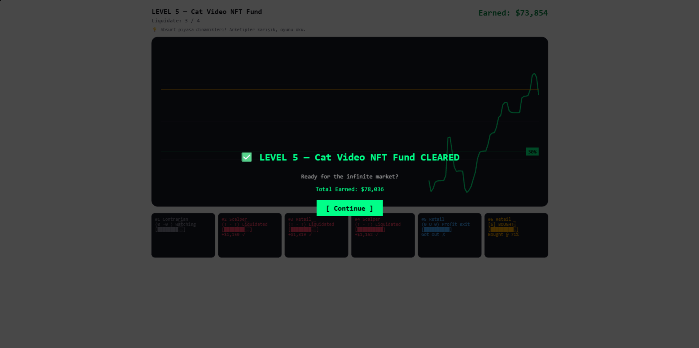

# Liquidation (Likidasyon)

> You are the stock chart. Your job is to ruin everyone who trusts you.

An absurd, web-based strategy game made solo in 1 month for [Jam name]. Theme: **absurdity**.


<!-- Create a screenshots/ folder and put your GIF or main screenshot there as gameplay.gif / gameplay.png -->

**[▶ Play on itch.io]([itch.io link])**

---

## About

In every finance game you're the investor trying to win. Here it's the opposite: you're the price line the investors are staring at, and you're trying to make them lose money.

There's a catch. If people lose interest, you can't do anything. If the price sits still, their interest drops, and if it hits zero the level restarts. To ruin them, you first have to keep them watching.

## How to play

- Move the price line up and down with **[controls: mouse / arrow keys / ...]**.
- Traders have an **interest** value. If the price stays flat, it drains.
- A trader who buys high and sells low takes a loss. Every loss pays you in cash (like `+$10,000`), and your total earnings add up across screens.
- Ruin the target number of traders to clear the level.
- If their interest runs out, the level restarts.
- The more you win, the smarter they get, so success makes the job harder.

## The traders

Four types: `retail`, `hodler`, `contrarian` and `scalper`. Each one reacts differently. Even within a single type, every trader gets its own random ±15% deviation, so they react at different moments instead of moving as a herd.

## Features

- 4 hand-made tutorial levels
- Endless mode after that: every level is randomly generated with 3-7 traders, random types and absurd stock names
- Cash balance that grows as you play
- Mini trading-terminal look: dark gray chart on a white page, ASCII interest bars and orange buy-tracking lines

## Why is it absurd?

You're a stock chart trying to ruin the traders who watch you, but to do it you have to keep them interested. The moment your victims stop looking at you, you lose. The better you do, the smarter they get, so your job gets harder, not easier. And the price of something with no real value exists only because people keep looking at it. The game takes that very seriously.

## Screenshots

| | |
|---|---|
|  |  |
| ![Level [x]](screenshots/level2.png) |  |

## Running locally

Download the files, open a terminal in the folder and start a local server (browsers may refuse to load some files when `index.html` is opened directly):

```
python -m http.server 8000
```

Then open `http://localhost:8000` in your browser.

<!--
If you use npm instead, replace the above with:

npm install
npm run dev
-->

## Built with

- [Phaser](https://phaser.io/) [version]
- JavaScript, HTML, CSS

## Author

[@farukaskaya](https://github.com/farukaskaya)

## License

[Pick a license, e.g. MIT. If you don't pick one, all rights are reserved by default]
